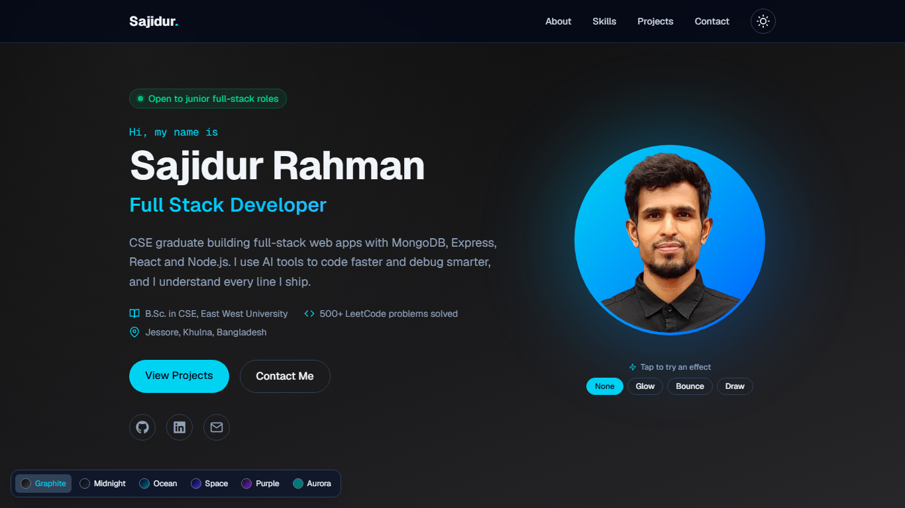

# Sajidur Rahman | Developer Portfolio

My personal portfolio website, built with **Next.js 16, React 19, TypeScript, Tailwind CSS v4 and Motion**.

🔗 **Live site:** [sajidur-portfolio.vercel.app](https://sajidur-portfolio.vercel.app)



## About

I'm a full-stack developer (MERN) with a B.Sc. in Computer Science & Engineering from East West University. This site introduces me, my skills and the projects I'm building, and lets recruiters contact me directly.

It is a single-page site. **All content lives in one typed data file** (`src/data/portfolio.ts`), so updating my bio, skills or projects never means touching component code.

## Features

- **TypeScript (strict)** everywhere: typed content, props and events
- **Light / dark mode** that remembers the visitor's choice, plus 6 dark background palettes
- **Hero effects:** Glow, Bounce and an anime.js "Draw" effect that draws my name
- **Animations with Motion:** fade-ins, skill logos that pop in, 3D title flips and card tilt
- **Respects "reduce motion"** accessibility settings
- **Working contact form** (Web3Forms) with loading, success and error states and a spam trap
- **SEO:** metadata, generated favicon and social preview image, robots.txt, sitemap.xml, custom 404
- **Optimized images** with `next/image`, self-hosted fonts with `next/font`
- **Small dependency list:** only the libraries the site really uses

## Tech Stack

| Area | Tools |
|---|---|
| Framework | Next.js 16 (App Router, Cache Components), React 19 |
| Language | TypeScript 5 (strict) |
| Styling | Tailwind CSS v4 |
| Animation | Motion, anime.js |
| Theme | next-themes |
| Icons | react-icons |
| Contact form | Web3Forms |
| Hosting | Vercel (auto-deploys on every push to `main`) + Vercel Analytics |

## Getting Started

**Requirements:** Node.js 20.9 or newer.

```bash
git clone https://github.com/sajidur70/sajidur-portfolio.git
cd sajidur-portfolio
npm install
npm run dev
```

Create `.env.local` in the project root:

```
NEXT_PUBLIC_WEB3FORMS_KEY=your-web3forms-access-key
```

| Command | What it does |
|---|---|
| `npm run dev` | Start the development server |
| `npm run build` | Production build (includes type checking) |
| `npm run start` | Run the production build |
| `npm run lint` | Check the code with ESLint |

## Contact

- **Email:** [sajidurrahmansahib@gmail.com](mailto:sajidurrahmansahib@gmail.com)
- **LinkedIn:** [sajidur-rahman-sajidur319370](https://www.linkedin.com/in/sajidur-rahman-sajidur319370/)
- **GitHub:** [@sajidur70](https://github.com/sajidur70)
